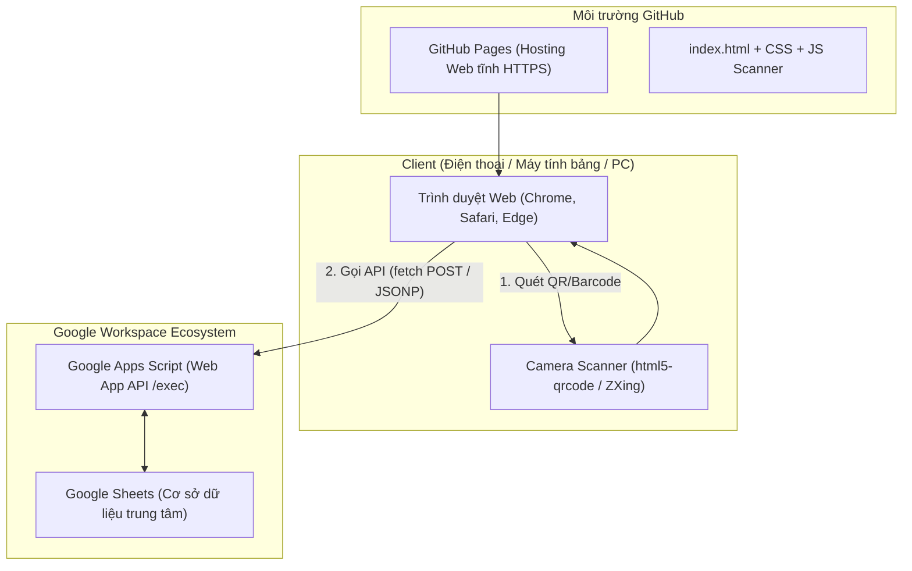

# BẢN THIẾT KẾ HỆ THỐNG KHO MŨ BTP (THÁI BÌNH SHOES / TBS GROUP)
> **Phiên bản:** 1.0 — Kiến trúc tinh gọn (GitHub Pages + Google Apps Script + Google Sheets)  
> **Kế thừa & Cải tiến từ:** Dự án Kho Đế (`d:\duan\kho-de`)  
> **Ngày lập:** 13/11/2026

---

## 1. MỤC TIÊU & ĐIỂM KHÁC BIỆT SO VỚI KHO ĐẾ

| Tiêu chí | Dự án Kho Đế cũ | **Dự án Kho Mũ mới** |
| :--- | :--- | :--- |
| **Môi trường Hosting Frontend** | Firebase Hosting (`kho-de-tbs.web.app`) | **GitHub Pages** (`https://<username>.github.io/<repo>/`) |
| **Môi trường chạy Camera** | Chạy trên Firebase Hosting | **Chạy trực tiếp trên GitHub Pages** (HTTPS chuẩn, cấp quyền `getUserMedia` 100%, không bị chặn iframe) |
| **Cơ sở dữ liệu & API** | Google Sheets + Apps Script | **Google Sheets + Apps Script** (giữ nguyên độ ổn định và miễn phí) |
| **Lệnh nhập ngoài (Import file ngoài)** | Có tab riêng `#receive` | **LOẠI BỎ** — Nhập trực tiếp qua quét camera / quét tem thùng |
| **Lệnh sản xuất (Vòng phom)** | Có module `#prod` rất lớn | **TẠM HOÃN** (chưa có phương án thực thi, ẩn hoàn toàn để hệ thống nhẹ nhất) |
| **Quy mô & Cấu trúc Sơ đồ kệ** | 37 kệ, khu A/B (3 tầng x 3 ô), C/D (3 tầng x 4 ô) | **Đúng 24 kệ — Mỗi kệ chuẩn 3 tầng × 4 ô = 12 ô/kệ (Tổng 288 ô toàn kho)** |

---

## 2. KIẾN TRÚC HỆ THỐNG (SYSTEM ARCHITECTURE)



### Ưu điểm khi dùng GitHub Pages thay vì Firebase:
1. **Không tốn chi phí & không cần setup phức tạp:** Không cần cài đặt `firebase-tools`, không cần tạo project GCP/Firebase Console.
2. **Quyền truy cập Camera hoàn hảo:** Trình duyệt di động bắt buộc kết nối HTTPS để mở Camera (`navigator.mediaDevices.getUserMedia`). GitHub Pages cấp sẵn chứng chỉ SSL miễn phí và tự động.
3. **Tách biệt hoàn toàn với giới hạn iframe của Google:** Web App chạy trên tên miền riêng của GitHub Pages, gọi API backend của Apps Script mượt mà, không bị xung đột chính sách bảo mật máy ảnh.

---

## 3. THIẾT KẾ SƠ ĐỒ KHO MŨ (24 KỆ × 3 TẦNG × 4 Ô)

### 3.1. Thông số kỹ thuật
- **Tổng số kệ:** 24 kệ.
- **Số tầng mỗi kệ:** 3 tầng:
  - **T3 (Tầng 3):** Trên cùng.
  - **T2 (Tầng 2):** Ở giữa.
  - **T1 (Tầng 1):** Ở đáy.
- **Số ô mỗi tầng:** 4 ô (Ô 1, Ô 2, Ô 3, Ô 4 từ trái qua phải).
- **Tổng số ô vị trí:** $24 \text{ kệ} \times 3 \text{ tầng} \times 4 \text{ ô} = 288 \text{ ô}$.

### 3.2. Phương án phân bổ mặt bằng (Layout Proposal)

**Phương án đề xuất (Chia làm 2 dãy song song hoặc 4 phân khu):**

```
DÃY A (Khu A: K01 -> K12)            [LỐI ĐI CHÍNH KHO MŨ]            DÃY B (Khu B: K13 -> K24)
---------------------------------                                     ---------------------------------
[K01] [K02] [K03] [K04] [K05] [K06]                                   [K13] [K14] [K15] [K16] [K17] [K18]
[K07] [K08] [K09] [K10] [K11] [K12]                                   [K19] [K20] [K21] [K22] [K23] [K24]
```

### 3.3. Cấu trúc hiển thị trực quan 1 Kệ trên giao diện

Mỗi nút Kệ trên sơ đồ hiển thị ma trận $3 \times 4$ trực quan:

```
┌──────────────────────────────────────────────┐
│  KỆ K01                      Đang chứa: 65%  │
├──────────────────────────────────────────────┤
│  T3 │ [ Ô 1 ]   [ Ô 2 ]   [ Ô 3 ]   [ Ô 4 ]  │  <- Tầng 3 (trên cùng)
│  T2 │ [ Ô 1 ]   [ Ô 2 ]   [ Ô 3 ]   [ Ô 4 ]  │  <- Tầng 2 (ở giữa)
│  T1 │ [ Ô 1 ]   [ Ô 2 ]   [ Ô 3 ]   [ Ô 4 ]  │  <- Tầng 1 (đáy)
├──────────────────────────────────────────────┤
│  4 loại mũ · 8 thùng/lô                      │
│  TỔNG TỒN: 1.250 đôi                         │
└──────────────────────────────────────────────┘
```

- **Màu sắc ô:**
  - ⬜ **Xám:** Ô trống.
  - 🟩 **Xanh lá:** Đang chứa hàng.
  - 🟧 **Cam:** Ô chứa gần đầy định mức.
  - 🟦 **Nhấp nháy xanh/đỏ:** Ô mục tiêu khi công nhân tìm vị trí mũ hoặc khi quét mã nhận gợi ý vị trí.

### 3.4. Quy ước mã định danh vị trí (Location Barcode)
- **Cú pháp mã vị trí:** `KE:{MãKệ}-T{Tầng}-O{Ô}`
  - Ví dụ: `KE:K01-T1-O1`, `KE:K05-T2-O3`, `KE:K24-T3-O4`.
- **Mã QR dán tại kho:**
  - In nhãn lớn dán đầu mỗi kệ: `KE:K01` (quét để mở cả kệ).
  - In nhãn nhỏ dán từng mép ô: `KE:K01-T1-O1` (quét để chọn chính xác ô thao tác).

---

## 4. MA TRẬN PHÂN HỆ CHỨC NĂNG (FEATURE MATRIX)

| Phân hệ | Trạng thái | Mô tả & Cách vận hành trong Kho Mũ |
| :--- | :---: | :--- |
| **1. Tổng quan (Dashboard)** | **GIỮ** | Thống kê số lượng tồn mũ (đôi/thùng), tỷ lệ lấp đầy 24 kệ, cảnh báo tồn chậm. |
| **2. Sơ đồ Kệ (Warehouse Map)** | **GIỮ (CHÍNH)** | Bản đồ 24 kệ (3 tầng x 4 ô). Bấm vào xem chi tiết, lọc theo mã mũ/model/size. |
| **3. Nhập kho nhanh (Inbound)** | **GIỮ** | Quét mã Kệ/Ô $\rightarrow$ Quét tem thùng $\rightarrow$ Nhập số lượng $\rightarrow$ Lưu. |
| **4. Xuất kho (Outbound)** | **GIỮ** | Chọn/quét ô kệ $\rightarrow$ Chọn lô/thùng $\rightarrow$ Xuất theo FIFO (hàng vào trước ra trước). |
| **5. Tồn kho & Lô thùng (Inventory)** | **GIỮ** | Danh sách tồn chi tiết theo Model - Màu - Size - Thùng - Vị trí ô kệ. |
| **6. Kiểm kê kho (Stocktake)** | **GIỮ** | Chọn kệ $\rightarrow$ Quét mã đối chiếu số thực tế vs số trên hệ thống. |
| **7. Tra cứu nhanh (Search)** | **GIỮ** | Nhập mã mũ / model $\rightarrow$ Bản đồ tự động định vị và **nhấp nháy đúng ô kệ**. |
| **8. In nhãn QR / Barcode (Labels)** | **GIỮ** | Tạo và in nhãn QR vị trí 24 kệ (288 ô) và nhãn thùng mũ. |
| **9. Nhật ký & Lịch sử (Logs)** | **GIỮ** | Lưu mọi lịch sử nhập/xuất/di chuyển của công nhân. |
| **10. Quản trị (Admin)** | **GIỮ** | Tài khoản, phân quyền công nhân/thủ kho, cấu hình hệ thống. |
| **-- Lệnh nhập ngoài** | **BỎ** | Lược bỏ hoàn toàn giao diện và bảng trung gian lệnh nhập ngoài. |
| **-- Lệnh sản xuất (Vòng phom)** | **TẠM HOÃN** | Ẩn toàn bộ để giao diện gọn gàng, khởi động tức thì. |

---

## 5. THIẾT KẾ CƠ SỞ DỮ LIỆU GOOGLE SHEETS

Sổ Google Sheets `Kho Mũ TBS` gồm 8 sheet cốt lõi:

1. **`Shelves` (24 dòng kệ, định nghĩa cấu trúc 288 ô):**
   - `ma` (K01...K24), `khu` (Khu A / Khu B), `soTang` (3), `soO` (4), `sucChua` (định mức đôi/thùng), `ghiChu`.
2. **`Items` (Danh mục mũ BTP):**
   - `ma` (Mã vật tư/mũ), `ten` (Tên mũ), `model`, `mau`, `size`, `dvt` (đôi/thùng), `quyCachThung` (số đôi/thùng), `keMacDinh`, `dinhMucMin`.
3. **`Lots` (Tồn kho theo lô / thùng & vị trí ô cụ thể):**
   - `maLo` (Mã lô/thùng), `maVT`, `tenVT`, `ke`, `tang` (1-3), `o` (1-4), `soLuongNhap`, `con` (tồn hiện tại), `ngayNhap`, `nguoiNhap`, `ghiChu`.
4. **`Receipts` & `ReceiptLines` (Phiếu nhập & xuất kho).
5. **`Logs` (Nhật ký mọi thao tác thời gian thực).
6. **`Users` (Tài khoản công nhân / thủ kho).
7. **`Counts` (Phiếu kiểm kê đối chiếu).
8. **`Config` (Cấu hình hệ thống).

---

## 6. KẾ HOẠCH BẮT TAY VÀO THỰC THI (NEXT STEPS)

1. **Bước 1 — Xây dựng Backend Apps Script (`Code.gs`):**
   - Tạo mã nguồn xử lý đọc/ghi Google Sheets cho 24 kệ $\times$ 3 tầng $\times$ 4 ô.
   - Tích hợp hàm `setupReal()` tự động tạo đủ cấu trúc bảng và 24 kệ chuẩn.
2. **Bước 2 — Xây dựng Giao diện Web tĩnh (`index.html`):**
   - Tinh gọn từ kho đế: Bỏ tab lệnh nhập ngoài và lệnh sản.
   - Cập nhật sơ đồ kho chuẩn 24 kệ ($3 \times 4$).
   - Nhúng mô-đun Camera Scanner trực tiếp qua thư viện `html5-qrcode`.
3. **Bước 3 — Đóng gói sẵn cho GitHub:**
   - Tạo sẵn repo/cấu trúc file để bạn chỉ cần push lên GitHub là GitHub Pages tự động chạy camera và đồng bộ Google Sheets!
